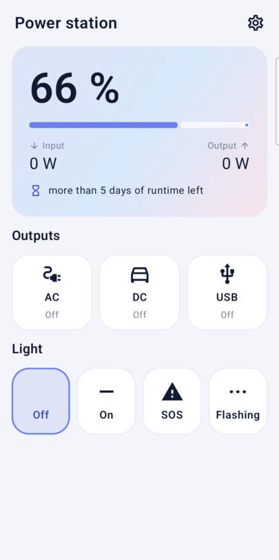
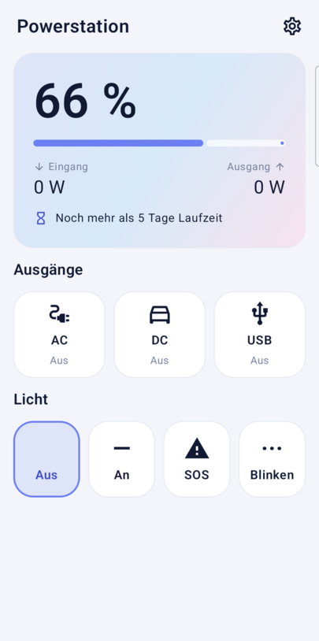

# Powerstation Control

A simple, unofficial Android app for **AFERIY P180** portable power stations (and possibly other
BrightEMS-compatible units). It talks to the power station directly over **Bluetooth LE** – no account, no cloud.

<p>
  
  
</p>

> **Unofficial project.** It is not affiliated with, endorsed by, or supported by AFERIY, BrightEMS, Fossibot or
> SYDPOWER. All product names and trademarks belong to their owners. The Bluetooth protocol was worked out by
> observing the official app on the author's own unit.

> **Tested on one device only.** This app has been tested **only on the author's own AFERIY P180**. Other power
> stations – including other AFERIY models and units that use the same app – may react differently or not at all,
> and a command that is harmless on one model could have unwanted effects on another.
>
> **Use at your own risk.** The protocol is undocumented, and writing settings to a device can have unexpected
> effects. The author accepts **no liability for any damage** to your power station, connected devices or anything
> else (see also sections 7 and 8 of the [Apache License 2.0](LICENSE)).

## Why this app?

I built this because the official app asks for **location access** just to talk to a Bluetooth device, and in my
experience its controls respond **much slower**. This app asks only for the "Nearby devices" permission on
Android 12+ (declared with `neverForLocation`), has no internet access, and sends each command directly to the
unit and confirms it by reading the state back.

## Features

- Battery level, input and output power, remaining runtime / time to full
- Switch the **AC**, **DC** and **USB** outputs, with the current output power shown on each button
- Light control: off, on, SOS, flashing
- Settings: display timeout (10 s – 30 min), charge limit, discharge limit
- Remembers your unit and reconnects automatically
- English and German (follows the system language; Android 13+ also offers a per-app language setting)
- Optional **developer options** (raw registers, change log, value finder) to help map more values
## Build

Requirements: JDK 17+ and the Android SDK (platform 35, build-tools 35). Then:

```sh
echo "sdk.dir=/path/to/Android/Sdk" > local.properties   # not committed
./gradlew testDebugUnitTest assembleDebug
```

The APK is written to `app/build/outputs/apk/debug/app-debug.apk`. Install it with `adb install -r …`.
Minimum Android version: 8.0 (API 26). Permissions: "Nearby devices" (Bluetooth scan/connect) on Android 12+; Android 8–11 require location permission for
Bluetooth LE scans, so the app requests it there only (it never reads your location). No internet permission.

## How it works (protocol notes)

BLE service `0xA002`; write characteristic `0xC304`, notify characteristic `0xC305`. Frames are Modbus-like:
`11 <function> … <CRC-16/MODBUS, high byte first>`. Replies are longer than one 20-byte notification and are
reassembled by length. The app polls every ~6 s, like the official app (faster polling was not tried).

| Purpose | Frame |
|---|---|
| Read status (100 registers) | `11 04 00 00 00 64 71 F3` |
| Read settings (100 registers) | `11 03 00 00 00 64 B1 46` |
| Output state (status register 75, bit `0x04` DC, `0x08` USB, `0x10` AC) | `11 05 4B 00 01 <value16> <crc>` |
| Light mode (status register 79: 0 off, 1 on, 2 SOS, 3 flashing) | `11 05 4F 00 01 00 <mode> <crc>` |
| Settings write (25 display timeout in s, 26 discharge limit ×10 %, 27 charge limit ×10 %) | `11 06 <reg8> 00 01 <value16> <crc>` |

The plain Modbus layout `11 06 <reg16> <value16>` is **rejected** by the P180 (the unit answers with function
`0x86` and beeps), and one invalid write to an unknown register made the unit drop the Bluetooth link. Some related units are
reported to be bricked by writing `0` to a particular register, so the app only writes the values listed above,
within safe ranges, and never writes `0` to unknown registers.

Status registers used: 31 battery %, 72 remaining minutes, 71 time to full (min), 12 AC output W, 13 USB output W,
78 DC+USB output W, 2 AC charging W, 3 DC/solar input W, 8/9 AC input V/Hz, 10/11 AC output V/Hz. Register 90 looks
like the signed battery power (negative while charging) but is not used yet. See `Protocol.kt` for the full list and `ProtocolTest.kt` for byte-exact test vectors taken from real captures.

### Mapping more values

Turn on **Settings → Developer options**. The app then shows raw registers and logs every change with a timestamp.
Press a button on the unit (or change a value in the official app, then reconnect this app), add a note, and copy
the report. To capture what the official app sends, enable *Bluetooth HCI snoop log* in Android's developer options,
use the official app, then pull `FS/data/log/bt/btsnoop_hci.log` from `adb bugreport` and filter ATT writes to the
characteristic above. Pull requests with verified registers for other models are very welcome.

## Credits

- Material Icons by Google (Apache-2.0) – see [THIRD_PARTY_NOTICES.md](THIRD_PARTY_NOTICES.md)
- Protocol research cross-checked with [ESP-FBot](https://github.com/Ylianst/ESP-FBot),
  [aferiy-p180-esphome](https://github.com/amukan/aferiy-p180-esphome) and
  [kraftverk](https://github.com/olofd/kraftverk). No code was copied from these projects.

## License

Copyright 2026 Marcel Leusch. Licensed under the Apache License 2.0 – see [LICENSE](LICENSE) and [NOTICE](NOTICE).
Third-party components and their licenses are listed in [THIRD_PARTY_NOTICES.md](THIRD_PARTY_NOTICES.md).
